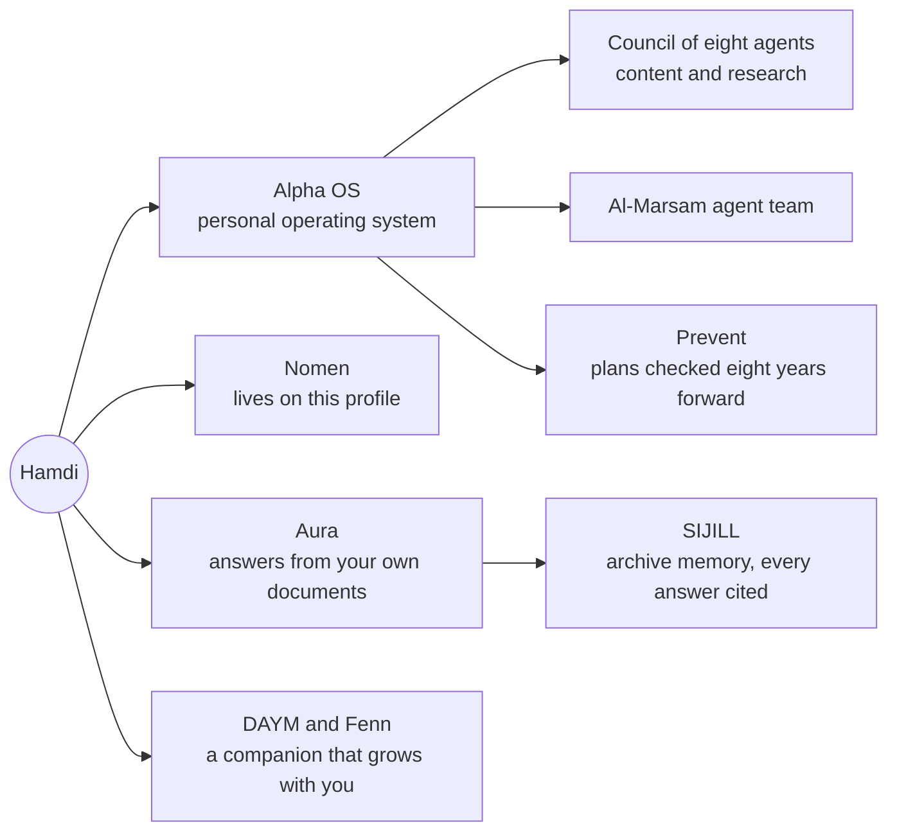

<a name="top"></a>

<p align="center">
  <a href="#about"></a>
</p>

<p align="center">
  <a href="#about"></a>
  <a href="#now"></a>
  <a href="#projects"></a>
  <a href="#agents"></a>
  <a href="#prevent"></a>
  <a href="#mynthmarks"></a>
  <a href="#community"></a>
  <a href="#path"></a>
  <a href="#support"></a>
</p>

<p align="center">
  <a href="#now"></a>
  <a href="#evolution-score"></a>
  <a href="#community"></a>
  <a href="#nomen"></a>
  <a href="#support"></a>
</p>

<a name="nomen"></a>

<p align="center">
  <a href="https://github.com/hamdibenjarrar/hamdibenjarrar/issues/new?title=nomen%3A+hello&body=Hello+Nomen."></a>
</p>

<a name="about"></a>

## About

I am a designer and developer from Tunis, working between Tunisia and Libya. I founded **MYNTHISM**, a creative AI studio where I design brand systems, build the websites, and wire the agents that run behind them. I work in Arabic, French and English.

I am self taught. My formal schooling ends at the baccalaureate (2014). I graduated from the GOMYCODE software developer bootcamp in April 2025 and have kept learning in public since. I also play jazz electro guitar.

<sub><a href="#top">Back to top</a></sub>

<a name="now"></a>

## Now

<p align="center">
  <a href="#projects"></a>
</p>

```json
{
  "name": "Hamdi Ben Jarrar",
  "base": "Tunis and Tripoli",
  "studio": "MYNTHISM",
  "role": "Innovation Sector Director and Project Lead, Al-Marsam Organization",
  "building": ["ALPHA", "Alpha OS", "Aura", "Ghazala Cinematic Lab website", "Tunisia Hopes"],
  "shipped": ["Prevent 0.1.0", "Mynthmarks", "npm Pulse", "Ghazala magazine issue 01"],
  "openTo": ["collaborations", "sponsors", "design and AI work"]
}
```

<sub><a href="#top">Back to top</a></sub>

<a name="projects"></a>

## Projects

| Project | What it is | Status | Open |
| :-- | :-- | :-- | :-- |
| **MYNTHISM** | Creative AI studio: brand systems, sites and the agents behind them | <a href="https://mynthism.vercel.app"></a> | <a href="https://mynthism.vercel.app"></a> |
| **ALPHA** | One home for the studio, the academy, a council of eight agents and my portfolio | <a href="https://alpha-drab-nine.vercel.app"></a> | <a href="https://alpha-drab-nine.vercel.app"></a> |
| **Prevent** | The layer after the model. Runs any AI output eight years forward and returns the best eight futures | <a href="#prevent"></a> | <a href="https://github.com/hamdibenjarrar/prevent"></a> |
| **Mynthmarks** | Glass badges for GitHub, with a public Evolution Score. This page wears them | <a href="https://mynthmarks.vercel.app"></a> | <a href="https://mynthmarks.vercel.app"></a> <a href="https://github.com/hamdibenjarrar/mynthmarks"></a> |
| **Aura** | Arabic first assistant that answers from an organisation's own documents and cites them | <a href="#agents"></a> | <a href="#agents"></a> |
| **Ghazala Cinematic Lab** | Magazine issue 01 designed and published. Animated website in Arabic, English and French | <a href="https://ghazala-cinematic-lab.vercel.app"></a> | <a href="https://ghazala-cinematic-lab.vercel.app"></a> |
| **Al-Marsam Organization** | Brand system in Arabic and English and a new Arabic first website for a Libyan cultural NGO | <a href="https://almarsm.org"></a> | <a href="https://almarsm.org"></a> |
| **npm Pulse** | Free, open API that gives any npm package a health score | <a href="https://npm-pulse.vercel.app"></a> | <a href="https://npm-pulse.vercel.app"></a> <a href="https://github.com/hamdibenjarrar/npm-Pulse"></a> |
| **god-designer** | A Claude skill for design, motion, marketing and growth. WCAG 2.1 AA | <a href="https://github.com/hamdibenjarrar/god-designer"></a> | <a href="https://github.com/hamdibenjarrar/god-designer"></a> |
| **awesome-arabic-dev** | Curated resources for Arabic speaking developers | <a href="https://github.com/hamdibenjarrar/awesome-arabic-dev"></a> | <a href="https://github.com/hamdibenjarrar/awesome-arabic-dev"></a> |
| **DinarWise** | Personal finance tracker | <a href="https://github.com/hamdibenjarrar/DinarWise"></a> | <a href="https://github.com/hamdibenjarrar/DinarWise"></a> |
| **Tunisia Hopes** | A sector by sector renewal plan for Tunisia, with a public vote and comments | <a href="#now"></a> | <a href="#now"></a> |
| **DAYM** | An always on AI companion for the Middle East and North Africa, with Fenn the fennec fox | <a href="#agents"></a> | <a href="#agents"></a> |

<sub><a href="#top">Back to top</a></sub>

<a name="agents"></a>

## AI and agents

Every agent I build has one job and a clear owner. This is how they connect.



| Agent | Job | Status |
| :-- | :-- | :-- |
| **Nomen** | Wakes every six hours, reads my public activity, redraws its own card and greets visitors | <a href="#nomen"></a> |
| **Alpha OS** | My personal operating system. Rotates free model providers, hands skills to sub agents, runs on my laptop and in the cloud | <a href="#agents"></a> |
| **Council of eight** | Eight agents that research, write and publish for the studio | <a href="https://alpha-drab-nine.vercel.app"></a> |
| **Prevent** | Checks a plan before it ships by running it years forward | <a href="#prevent"></a> |
| **Aura** | Lives in a small organisation's site, answers from its documents, cites sources, hands over to a human | <a href="#projects"></a> |
| **SIJILL** | Makes an institution's paper archive readable and auditable. No answer without a citation to a real page | <a href="#projects"></a> |
| **Fenn** | The DAYM companion. Starts small and grows with each person | <a href="#projects"></a> |

<sub><a href="#top">Back to top</a></sub>

<a name="prevent"></a>

## Prevent, the layer after the model

<a href="https://github.com/hamdibenjarrar/prevent"></a>
<a href="https://github.com/hamdibenjarrar/prevent/actions/workflows/ci.yml"></a>
<a href="https://github.com/hamdibenjarrar/prevent#models"></a>

Give Prevent any output, a plan, a draft, a decision, and it runs it years forward, branch by branch, scores every path, and hands back the best eight futures with the moves that keep each one reachable from today. It is not a prophet. A future is a scored scenario with its assumptions written down.

1. **Branch.** Each year, every kept future splits into concrete next states, good, neutral and bad.
2. **Score.** Every state gets four numbers from 0 to 1: plausibility, value, reversibility, risk.
3. **Beam.** The best eight survive the year. A path is scored by the geometric mean of its years, so one implausible year sinks it.
4. **Lock.** The final eight get a name, the assumptions they rest on, and three moves to make this month.

The scoring, straight from [`prevent/engine.py`](https://github.com/hamdibenjarrar/prevent/blob/main/prevent/engine.py):

```python
def score_node(n: Node) -> float:
    """One number for ranking. Value matters most, plausibility second, risk subtracts, reversibility
    softens risk. Kept simple on purpose so anyone can read why a future ranked where it did."""
    return round(0.45 * n.value + 0.35 * n.plausibility + 0.20 * n.reversibility - 0.25 * n.risk * (1 - n.reversibility), 4)


def _trajectory_score(nodes: list[Node], i: int) -> float:
    """Geometric mean of the scores along the path: one implausible year sinks the whole future."""
    vals, cur = [], i
    while cur is not None and nodes[cur].parent is not None:
        vals.append(max(1e-6, nodes[cur].score))
        cur = nodes[cur].parent
    return math.exp(sum(math.log(v) for v in vals) / len(vals)) if vals else 0.0
```

Run it on your own machine with any local model:

```bash
pip install git+https://github.com/hamdibenjarrar/prevent
ollama pull qwen2.5:7b
prevent "I launch a one person AI studio in Tunis with no funding" --years 8 --out futures
```

<sub><a href="#top">Back to top</a></sub>

<a name="mynthmarks"></a>

## Mynthmarks

Every badge on this page is a Mynthmark, a glass badge system I designed and opened to everyone. They show where work stands, not only how many stars it has: status, progress, tasks, tools, evolution, community, agents and support.

<a href="https://mynthmarks.vercel.app"></a>
<a href="https://mynthmarks.vercel.app"></a>
<a href="https://mynthmarks.vercel.app"></a>
<a href="https://mynthmarks.vercel.app"></a>
<a href="https://mynthmarks.vercel.app"></a>
<a href="https://mynthmarks.vercel.app"></a>

Put one on your own README in one line, and always wrap it in a link so a click goes somewhere real:

```markdown
[](#your-section)
[](https://github.com/YOUR-NAME)
```

<a name="evolution-score"></a>

### The Evolution Score

A public number from 0 to 1000 built from a year of activity. Every part saturates, so one huge week cannot max it. Steady work wins. Levels go Seed, Sprout, Grove, Canopy, Myth. Mine starts at Seed, and that is the point: it is honest and it grows.

<a href="https://mynthmarks.vercel.app/api/json?source=live&metric=evolution&detail=1&user=hamdibenjarrar"></a>

```js
// From lib/evolution.js in Mynthmarks
export const WEIGHTS = { volume: 0.3, consistency: 0.2, streak: 0.15, momentum: 0.15, reach: 0.1, range: 0.1 };
const sat = (x, k) => 1 - Math.exp(-Math.max(0, x) / k);

export function evolution(s) {
  const days = s.days || [];
  const parts = {
    volume: sat(s.totalContributions || 0, 1000),
    consistency: days.length ? clamp(days.filter((d) => d.count > 0).length / days.length) : 0,
    streak: sat(streaks(days).current, 30),
    momentum: momentum(days),
    reach: sat((s.stars || 0) + (s.followers || 0), 200),
    range: sat((s.languages || []).length, 6),
  };
  const score = Math.round(1000 * Object.keys(WEIGHTS).reduce((a, k) => a + WEIGHTS[k] * parts[k], 0));
  const level = LEVELS.find((l) => score >= l.min).name;
  return { score, level, parts, version: VERSION };
}
```

Open the [builder](https://mynthmarks.vercel.app), read the [source](https://github.com/hamdibenjarrar/mynthmarks), or see every part of [my score](https://mynthmarks.vercel.app/api/json?source=live&metric=evolution&detail=1&user=hamdibenjarrar).

<sub><a href="#top">Back to top</a></sub>

<a name="community"></a>

## Community and contributions

<a href="https://github.com/hamdibenjarrar?tab=overview"></a>
<a href="https://github.com/hamdibenjarrar?tab=overview"></a>
<a href="https://github.com/hamdibenjarrar?tab=overview"></a>
<a href="https://github.com/hamdibenjarrar?tab=repositories"></a>
<a href="https://github.com/hamdibenjarrar?tab=repositories"></a>
<a href="https://github.com/hamdibenjarrar?tab=followers"></a>

**Merged into open source projects**

| Project | What I added | |
| :-- | :-- | :-- |
| EbookFoundation / free-programming-books | Pro Git in Arabic | <a href="https://github.com/EbookFoundation/free-programming-books/pull/13176"></a> |
| npmx.dev | Missing Egyptian Arabic and French translation keys | <a href="https://github.com/npmx-dev/npmx.dev/pull/2315"></a> |
| npmx.dev | A package health score widget powered by npm Pulse, proposed | <a href="https://github.com/npmx-dev/npmx.dev/pull/2333"></a> |

**Communities I build with**

<a href="https://almarsm.org"></a>
<a href="https://ghazala-cinematic-lab.vercel.app"></a>
<a href="https://github.com/hamdibenjarrar/awesome-arabic-dev"></a>

<p align="center">
  <a href="https://github.com/hamdibenjarrar/hamdibenjarrar/blob/main/.github/workflows/snake.yml">
    <picture>
      <source media="(prefers-color-scheme: dark)" srcset="https://raw.githubusercontent.com/hamdibenjarrar/hamdibenjarrar/output/github-contribution-grid-snake-dark.svg">
      <source media="(prefers-color-scheme: light)" srcset="https://raw.githubusercontent.com/hamdibenjarrar/hamdibenjarrar/output/github-contribution-grid-snake.svg">
      
    </picture>
  </a>
</p>

<sub><a href="#top">Back to top</a></sub>

<a name="path"></a>

## Path and toolkit

<p align="center">
  <a href="https://www.linkedin.com/in/hamdibenjarrar"></a>
</p>

<p align="center">
  <a href="https://github.com/hamdibenjarrar?tab=repositories"></a>
</p>

<details>
<summary><b>Toolkit as text</b></summary>

<br>

| Area | Tools |
| :-- | :-- |
| Interface | React, Next.js, TypeScript, Tailwind, Motion, GSAP, Three.js |
| Server | Node, Express, Python, FastAPI |
| Data | Supabase, PostgreSQL, MongoDB |
| AI | LLM APIs, RAG, multi agent systems, MCP, n8n |
| Ship | Vercel, Cloudflare, Docker, GitHub Actions |
| Design | Brand identity, art direction, motion |

</details>

<sub><a href="#top">Back to top</a></sub>

<a name="support"></a>

## Support

<a href="mailto:hamdibenjarrar@gmail.com?subject=Supporting%20your%20work"></a>
<a href="https://github.com/hamdibenjarrar/mynthmarks"></a>
<a href="https://github.com/hamdibenjarrar/prevent"></a>
<a href="https://mynthmarks.vercel.app"></a>

Everything I open source is free and stays free. If it helps you, here is how to give back:

1. **Sponsor a project or fund a feature.** GitHub Sponsors is being set up for this profile. Until it opens, [write to me](mailto:hamdibenjarrar@gmail.com?subject=Supporting%20your%20work) and we agree on it directly.
2. **Star and share.** Stars on [Prevent](https://github.com/hamdibenjarrar/prevent) and [Mynthmarks](https://github.com/hamdibenjarrar/mynthmarks) help other people find them.
3. **Wear a Mynthmark.** Every profile that uses them makes the system stronger.
4. **Hire the studio.** Brand systems, websites and agents, from [MYNTHISM](https://mynthism.vercel.app).

<p align="center">
  <a href="https://www.linkedin.com/in/hamdibenjarrar"></a>
  <a href="https://www.instagram.com/hamdibenjarrar"></a>
  <a href="mailto:hamdibenjarrar@gmail.com"></a>
  <a href="https://mynthism.vercel.app"></a>
  <a href="https://github.com/hamdibenjarrar/hamdibenjarrar/issues/new?title=nomen%3A+hello&body=Hello+Nomen."></a>
</p>

<details>
<summary><b>How Nomen lives here</b></summary>

<br>

Nomen is a small scripted agent, not a chatbot. A scheduled GitHub Action wakes it every six hours. It reads my public activity, decides whether it is awake or resting, and redraws its own card.

It also remembers visitors. Open an issue whose title starts with `nomen`, and it will answer you, close the issue, and write your username on its card.

```yaml
# .github/workflows/nomen.yml, shortened
on:
  schedule:
    - cron: "17 */6 * * *"   # every six hours
  issues:
    types: [opened]          # a visitor said hello
jobs:
  wake:
    steps:
      - run: node scripts/nomen.mjs   # read activity, remember visitors, redraw assets/nomen.svg
```

The cards on this page are plain SVG drawn by two scripts in [`scripts/`](scripts), with no outside widgets. The badges come from [Mynthmarks](https://github.com/hamdibenjarrar/mynthmarks).

</details>

<p align="center"><sub><a href="#top">Back to top</a></sub></p>
