  

  

### Hello, I am Hamdi

I am a designer and developer from Tunis, working between Tunisia and Libya. I founded **MYNTHISM**, a creative AI studio where I design brand systems, build the websites, and wire the agents that run behind them. I work in Arabic, French and English.

I am self taught. My formal schooling ends at the baccalauréat (2014). I graduated from the GOMYCODE software developer bootcamp in April 2025 and have kept learning in public since.

  

| Project | What it is | Link |
| :-- | :-- | :-- |
| **MYNTHISM** | Creative AI studio | [mynthism.vercel.app](https://mynthism.vercel.app) |
| **Aura** | Arabic first assistant that answers from an organisation's own documents and cites them | In progress |
| **Ghazala Cinematic Lab** | Animated website in Arabic, English and French, and the magazine design, for a film lab in Tripoli | [Preview](https://ghazala-cinematic-lab.vercel.app) |
| **npm Pulse** | Free, open API that gives any npm package a health score | [npm-pulse.vercel.app](https://npm-pulse.vercel.app) · [Code](https://github.com/hamdibenjarrar/npm-Pulse) |
| **awesome-arabic-dev** | Curated resources for Arabic speaking developers | [Code](https://github.com/hamdibenjarrar/awesome-arabic-dev) |
| **DinarWise** | Personal finance tracker | [Code](https://github.com/hamdibenjarrar/DinarWise) |

  

  

  <picture>
    <source media="(prefers-color-scheme: dark)" srcset="https://raw.githubusercontent.com/hamdibenjarrar/hamdibenjarrar/output/github-contribution-grid-snake-dark.svg">
    <source media="(prefers-color-scheme: light)" srcset="https://raw.githubusercontent.com/hamdibenjarrar/hamdibenjarrar/output/github-contribution-grid-snake.svg">
    
  </picture>

  
  
  
  
  

<b>How Nomen lives here</b>

 

Nomen is a small scripted agent, not a chatbot. A scheduled GitHub Action wakes it every six hours. It reads my public activity, decides whether it is awake or resting, and redraws its own card.

It also remembers visitors. Open an issue whose title starts with `nomen`, and it will answer you, close the issue, and write your username on its card.

Everything on this page is plain SVG drawn by two scripts in [`scripts/`](scripts), with no outside widgets.

